# Generative-AI-Enabled Autonomous Agents

**A language model proposes a task plan; deterministic code checks it, assigns it to robots, keeps it safe, and replans when something breaks.**
A simulation-first Python project for *task decomposition and dynamic allocation among heterogeneous autonomous agents* — fully runnable offline, with tests and reproducible experiments.

> **Please read first (honest scope).** Everything here is verified in a **grid simulator only** — no hardware, no formal safety claim. All reported results use a **keyword mock planner, not a real LLM**; the optional real-LLM adapter has **never been run against the live API**. Details: [What is and is not implemented](#what-is-and-is-not-implemented).

| I want to… | Go to |
|---|---|
| **Run it and check it works (3 commands)** | [Quick start](#quick-start-3-commands-no-api-key) |
| **See the results without installing anything** | [Results at a glance](#results-at-a-glance) |
| **Verify every claim made here** | [Verify the claims](#verify-the-claims) |
| Understand how it works | [How it works](#how-it-works) · [`docs/ARCHITECTURE.md`](docs/ARCHITECTURE.md) |
| What is novel here, and what comes next | [Novelty and contributions](#novelty-and-contributions) |
| Try a real LLM (optional) | [Optional: real LLM](#optional-real-llm-provider) |
| ROS 2 / Gazebo validation (planned, **not implemented**) | [ROS 2 roadmap](#ros-2-and-gazebo-validation-roadmap-not-implemented) |
| Something failed | [Troubleshooting](#troubleshooting) |

---

## Quick start (3 commands, no API key)

**Needs:** Linux, macOS or Windows-WSL terminal · `git` · **Python 3.10 or newer** (with `venv`) · internet for `pip install` only.
**Ubuntu/Debian:** if needed first run `sudo apt install -y python3 python3-venv python3-pip git`.

```bash
git clone https://github.com/KrishnaMowli/Generative-AI-Enabled-Autonomous-Agents.git
cd Generative-AI-Enabled-Autonomous-Agents
bash scripts/quickstart.sh
```

All commands in this README are run **from this folder** (the one containing `README.md`, `pyproject.toml` and `src/`).

The script creates a private `.venv`, installs the dependencies, and runs 4 checks (~2–4 minutes). **Success looks like:**

```
OK: settings (digest 4c5c4f6813c4) and 14 scenarios are valid                                   <- step 2
--- with replanning ...    Mission 's3_agent_failure': COMPLETE   tasks 7/7  ... REPLAN v2     <- step 3
--- WITHOUT replanning ... Mission 's3_agent_failure': INCOMPLETE tasks 4/7  ...               <- step 3
535 passed in ~20s                                                                              <- step 4
OK: every saved trace reproduces its metrics row in runs.csv                                    <- step 5
ALL CHECKS PASSED.
```

Step 3 is the headline demo: one of three agents fails mid-mission. **With replanning** the system reassigns the unfinished work and completes 7/7 tasks; **without it** the mission stops at 4/7 and says exactly why for each unfinished task.

After the script, activate the environment for further commands: `source .venv/bin/activate`. Something went wrong? See [Troubleshooting](#troubleshooting).

## Results at a glance

These were generated by this repo's own code (mock planner, 14 scenarios × 7 variants × 30 seeds = **2,940 simulated missions**). Full auto-generated report: [`results/report.md`](results/report.md).

**Mission success rate per scenario and variant** (green = completes; the red cells are *intended*: those scenarios have no feasible solution or a deliberately broken plan, and the correct behaviour is to fail safely and say why):


**An agent fails mid-mission and the system replans** (red = failed task; the remaining work moves to other agents):


Key numbers (from [`results/runs.csv`](results/runs.csv), reproduced by `python scripts/headline_numbers.py`):

| Finding | Result |
|---|---|
| Agent failure, **no replanning** vs **MILP + replanning** | 0/30 vs 25/30 missions completed (greedy/online variants with replanning: 30/30) |
| New task arrives mid-mission, no replanning vs replanning | 0/30 vs 30/30 |
| Planner returns malformed / cyclic output, or the provider is down | **0 plans executed**, in all 540 such runs (fails closed) |
| Scenarios with no feasible solution (low battery, unreachable zone, lost only reporter) | 0 false successes in 630 runs — each reports a reason per task |
| Simulated collisions | **0** in all 2,940 runs (evidence for these scenarios only, not a safety guarantee) |
| Nominal mission, makespan: MILP vs greedy | 293 s vs 357 s (paired difference −64 s, 95 % CI [−96, −30]); the simple online *nearest-feasible* baseline is faster still (247.5 s) — "optimal" does not mean "best at everything" |

Why MILP + replanning completes only 25/30 after a failure: every miss is a battery limit — its static energy budget under-estimates chained routes, the safety gate refuses the over-long task, and the mission reports `EXCLUDED_AFTER_REJECTION(BATTERY_RESERVE)`. Explained in [`docs/ALLOCATION.md`](docs/ALLOCATION.md).

## Verify the claims

Run after the quick start, from the repository root, with the environment active (`source .venv/bin/activate`; also `export PYTEST_DISABLE_PLUGIN_AUTOLOAD=1` if your shell has ROS sourced). All offline.

| # | Claim | Command | Expected | Time |
|---|---|---|---|---|
| 1 | The test suite passes | `python -m pytest` | `535 passed` | ~25 s |
| 2 | Settings and all 14 scenarios are valid | `autocollab validate-config` | `OK: settings (digest 4c5c4f6813c4) and 14 scenarios are valid` | 1 s |
| 3 | Offline; replanning recovers from agent failure | `autocollab demo --failure` | `tasks 7/7` with replanning, `tasks 4/7` without | 2 s |
| 4 | Saved results can be recomputed from the raw event logs | `autocollab verify-traces --results results` | `OK: every saved trace reproduces its metrics row in runs.csv` | 1 s |
| 5 | The numbers in this README come from the saved data | `python scripts/headline_numbers.py` | table with `collisions ... all runs: 0`, success counts | 1 s |
| 6 | Every requirement is traced to a real test | `python scripts/check_traceability.py` | `86 referenced tests, 167 collected test functions; missing: none` | 3 s |
| 7 | **All 2,940 runs reproduce identically** | `autocollab experiments --seeds 30 --jobs 2 --out results_check` then `python scripts/verify_reproduction.py results_check` | `OK: 2940 freshly generated runs are identical to the committed results (wall-clock columns ignored)` | ~2 min |
| 8 | Prompt-injection and every persistent bad planner output are rejected | `autocollab planner-eval --provider mock --out results_check/planner_eval` | `"adversarial_rejected": [1, 1, 1]` and `"fault_modes_executed_when_persistent": 0` | 2 s |
| 9 | Everything end to end (tests, experiments, plots, report) | `SEEDS=30 JOBS=2 scripts/run_all.sh` | exits 0; last line `OK: every saved trace reproduces ...` | ~2 min |

Evidence to read: [`results/report.md`](results/report.md) · [`docs/TRACEABILITY.md`](docs/TRACEABILITY.md) (requirement → test, incl. the mutation check: 15 deliberate code breakages, all caught) · [`docs/EXPERIMENTS.md`](docs/EXPERIMENTS.md) (metric definitions, statistics) · [`docs/PROJECT_STATUS.md`](docs/PROJECT_STATUS.md) (status, defect log, limitations).

Try your own mission (mock planner understands zone names and the words *inspect*, *readings*, *report*):
```bash
autocollab run --mission "Inspect zones A and B, then compile a report."
autocollab run --scenario scenarios/s5_invalid_plan.yaml     # cyclic plan -> rejected, nothing executes, exit code 1
```

## How it works

```mermaid
flowchart LR
  M[Mission text] --> S[Sanitize + injection screen]
  S --> P[LLM planner<br/>mock / Anthropic]
  P -->|raw JSON| V1[Schema validator]
  V1 --> V2[Semantic validator<br/>allowlists, DAG, coverage, feasibility]
  V2 -->|accepted only| A[Allocator<br/>MILP / Hungarian / greedy / nearest]
  V2 -.reject / one bounded repair.-> P
  A --> C[Coordinator<br/>dependency scheduler + replanner]
  C --> SM[SafetyMonitor<br/>every dispatch and move]
  SM --> SIM[Grid simulator<br/>ground truth]
  SIM --> L[(JSONL event log)]
  L --> MET[Metrics, experiments, report]
  SIM -- fault / blocked cell / new task --> C
```



- The **LLM only proposes** a structured task list. It never assigns robots, never issues movement commands, and a task counts as done only when the simulator's postcondition holds.
- **Invalid or unsafe plans are rejected, never silently fixed.** Bad output gets at most one repair attempt, then the mission fails closed.
- On a fault (agent failure, blocked route, new task, low battery, deadlock) the system **replans only the unfinished work**; completed tasks are never redone.

Deep dives: [`docs/ARCHITECTURE.md`](docs/ARCHITECTURE.md) (diagrams, state machine) · [`docs/ALLOCATION.md`](docs/ALLOCATION.md) (cost function, MILP formulation, assumptions) · [`docs/SAFETY.md`](docs/SAFETY.md) (what the safety layer does and does not guarantee).

## Novelty and contributions

> **How to read this section.** "Novel" here means *design choices and evaluation practices combined in this repository*, each backed by tests or measurements you can rerun. **No literature survey was done, so no claim of research novelty is made.** The second part lists extensions that are only *planned*; their benefits are hypotheses, not results.

### A. What this repository demonstrates (built, tested, measured)
| # | Contribution | Evidence you can check |
|---|---|---|
| 1 | **Authority boundary around the LLM.** Model output is treated as untrusted data: strict schema, no extra fields, one bounded repair, then fail closed. The model never assigns robots or issues motion. | 24 corruption modes tested (malformed, cyclic, extra `assigned_agent` field, command-like criteria, oversized, …; one is benign code-fenced valid JSON, accepted by design): **none of the 23 harmful ones executes** when the corruption persists — `autocollab planner-eval`, `tests/test_planner.py` |
| 2 | **Two-way mission-coverage check.** Beyond "valid JSON": every required outcome must appear *and* no unrequested task may appear (`COVERAGE_MISSING` / `UNREQUESTED_TASK`), so a fluent but wrong plan is rejected. | `tests/test_plan_validation.py`, scenario `s5_invalid_plan` |
| 3 | **Hard feasibility kept separate from cost.** Infeasible pairs get no MILP variable (or are discarded after Hungarian solving); they are never "made expensive". The MILP is checked against exhaustive enumeration. | `tests/test_allocation.py::test_milp_matches_exhaustive_enumeration`, [`docs/ALLOCATION.md`](docs/ALLOCATION.md) |
| 4 | **An independent gate that catches an optimistic optimiser.** When the MILP's static energy budget is too optimistic after a failure, the SafetyMonitor's dispatch check refuses the task and the mission reports the cause instead of draining a robot. | s3: MILP+replan 25/30; every miss is `EXCLUDED_AFTER_REJECTION(BATTERY_RESERVE)`; `tests/test_coordinator_replan.py::test_recovery_limited_by_battery_is_reported_and_the_monitor_gate_catches_it` |
| 5 | **Replanning that never redoes finished work.** Completed tasks are immutable; retries depend on side-effect risk (`safe_to_retry`, `verify_before_retry`, `no_automatic_retry`); events are debounced. | Replanning ablation: 0/30 → 25–30/30 (s3, s7, s8); `tests/test_coordinator_replan.py` |
| 6 | **"Honest failure" as a correct outcome.** Infeasible scenarios (low battery, unreachable zone, lost only reporter) must end `INCOMPLETE` with a reason per task. A bug found during development — an injected task silently ignored, inflating a baseline — is guarded by a regression test. | 0 false successes in 630 infeasible-scenario runs; `tests/test_regressions.py` |
| 7 | **Evaluation methodology.** Paired seeds with random streams keyed by `(seed, label)` (independent of execution order); metrics computed *only* from event logs and recomputable from saved traces; independent per-tick collision audit shown to catch an unsafe monitor; test suite mutation-checked (15 deliberate breakages caught). | `autocollab verify-traces`, `scripts/verify_reproduction.py`, [`docs/TRACEABILITY.md`](docs/TRACEABILITY.md) |
| 8 | **Comparison that does not flatter the optimiser.** Nearest-feasible, Hungarian, greedy and MILP are compared under one common objective; the simple online baseline is faster on makespan (247.5 s vs MILP 293 s), and MILP's advantage on its own objective is reported as such. | `results/report.md` §4 |

### B. What can be done next, per the roadmap (planned — not implemented)
| Extension | What it would add | Status / what is needed |
|---|---|---|
| **ROS 2 + Gazebo validation** | Tests whether the *unchanged* mission layer and its safety rules hold under typed ROS 2 interfaces, a navigation stack and continuous motion; adds new metrics (minimum separation distance, message-drop sensitivity). Staged S0–S4 plan in [`docs/ROS2_ROADMAP.md`](docs/ROS2_ROADMAP.md). | **Not implemented.** Needs a `RobotInterface` refactor, ROS 2 packages, a Gazebo world; the safety argument for continuous space must be re-derived. |
| **Real-LLM planner evaluation** | Real measurements of plan validity, coverage, latency, cost and nondeterminism with the same validators and fault matrix. | Adapter exists and is unit-tested with a fake transport; needs an API key and a logged evaluation run. |
| **Route-aware MILP** | Removes the static-assignment weakness behind the s3 battery misses (sequence-dependent travel and energy). | Modelling + re-run of the allocation comparison. |
| **LLM re-decomposition on mission change** | Replan the *task graph itself*, not just assignments, when the mission changes — still through the same validators. | Not implemented (events currently use the deterministic allocator only). |
| **Communication delay / loss** | `COMMUNICATION_DELAY` events and stale-state handling (planned as ROS 2 stage S4). | Not implemented. |
| **Hardware path** | Only after robot-level collision avoidance, emergency stop, watchdog and battery failsafes are designed and reviewed. | Out of scope; no hardware validation exists. |

## What is and is not implemented

| Implemented and tested | Not implemented / unverified |
|---|---|
| Strict LLM output schema, semantic validation, bounded repair, fail-closed | **Live LLM calls** — adapter only, unit-tested with a fake transport; model name `claude-sonnet-5-5` unverified |
| Prompt-injection screening + structural defence (output is data; extras rejected) | Robust injection defence (pattern screening is evadable; the boundary is validation + no execution authority) |
| MILP, Hungarian, greedy, nearest-feasible allocators with hard battery/capability/reachability constraints | Route-aware (sequence-dependent) MILP; deadline penalties |
| Grid simulator, A*, conflict handling, independent collision audit | Continuous dynamics, localisation, any hardware validation |
| Replanning for failures, blocked cells, new tasks, low battery, deadlock; retry policies | `COMMUNICATION_DELAY` events; automatic LLM re-decomposition on mission change |
| 14 scenarios × 7 variants × 30 seeds, confidence intervals, plots, auto-report | Real-LLM evaluation results |
| — | **ROS 2 / Gazebo** (optional extension; **not implemented** — see the [roadmap](#ros-2-and-gazebo-validation-roadmap-not-implemented)) |

Modelling assumptions: failure scenarios s3/s8/s10 assume the failed agent is cleared from the grid (the stricter default is tested separately); added tasks are not retro-fitted into an existing report's prerequisites. Full list in [`docs/PROJECT_STATUS.md`](docs/PROJECT_STATUS.md).

## ROS 2 and Gazebo validation (roadmap, not implemented)

> **Status: planned, not built.** This repository has **no ROS 2 code and no ROS 2/Gazebo results**; nothing in the results above was validated with ROS 2. The project guide lists ROS 2 + Gazebo as an *optional extension to start only after the simulator-first project passes its exit gates*; the core project does, so this is the natural next milestone. Full plan: [`docs/ROS2_ROADMAP.md`](docs/ROS2_ROADMAP.md).

**Goal:** test whether the *unchanged* mission layer (planner → validators → allocator → coordinator → SafetyMonitor) and its safety rules still hold when robots are driven through ROS 2 interfaces and a continuous simulator, instead of the discrete grid.

**Planned design (proposed):**
- **Same mission layer, new robot boundary.** The LLM still emits task specifications only. A `RobotInterface` abstraction (needs a refactor; not yet present) would have two implementations: the current grid simulator and a ROS 2 one.
- **One ROS 2 namespace per agent**, 2–3 robots in a small Gazebo world with static obstacles and reproducible task areas.
- **Typed messages/actions only** (task command, task result, agent status, fault event) — never free-form text; navigation delegated to an established stack such as Nav2.
- **Hard gate kept:** every dispatch passes the deterministic SafetyMonitor *before* an action goal is sent; stale messages (old plan/world version) are discarded.
- **Same JSONL event log** plus ROS and simulation timestamps, QoS settings and message drops, so the existing metrics code can be reused.

**Staged validation:** S0 one-agent parity → S1 multi-agent nominal → S2 blocked route → S3 agent failure + replanning → S4 delayed/dropped/stale messages (this also covers `COMMUNICATION_DELAY`, which the grid project does not implement). Metrics compared against the grid baselines: success, completion rate, makespan ratio, distance, replan recovery time, message-drop sensitivity, and minimum separation distance (new in continuous space).

**Acceptance gate (from the guide):** the ROS 2 version must preserve the same safety rules — the LLM emits task specs only, invalid plans are rejected, dependencies are checked, and every low-level action is mediated by a deterministic robot interface. Physical deployment stays out of scope until hardware-specific collision avoidance, emergency stop, watchdog, battery failsafes and an operational safety review exist.

**What it could and could not establish.** *Could:* the mission-layer logic and safety gate behave consistently under ROS 2 interfaces and continuous motion, with quantified differences from the grid model. *Could not:* safety on physical robots, real-LLM planner quality, or allocation optimality. **Open risks** (not yet investigated): the discrete→continuous abstraction gap (the grid collision rules do not transfer and must be re-derived), conflicts between Nav2 recovery behaviours and the central monitor, timing/QoS effects, localisation uncertainty, and less deterministic Gazebo runs.

## Repository layout
```
README.md  LICENSE  pyproject.toml  requirements.txt  requirements-lock.txt (exact tested versions)
config/default.yaml     settings: cost weights, limits, task catalog
scenarios/              14 scenario YAMLs + labelled planner prompts
prompts/                versioned planner prompt            schemas/   JSON Schemas generated from the models
src/autonomous_collab/  models, config, environment, simulator, coordinator, runner, metrics, experiments, analysis, plotting, reporting, cli
  planner/              provider interface, mock / fault-injecting / Anthropic providers, mission screening, LLMPlanner
  validation/           schema validator, semantic validator, safety monitor
  allocation/           cost model, MILP, Hungarian, greedy, nearest
tests/                  535 tests (unit, component, integration, fault injection, regression)
scripts/                quickstart.sh, run_all.sh, run_demo.sh, headline_numbers.py, verify_reproduction.py, check_traceability.py, export_schemas.py
docs/                   ARCHITECTURE, ALLOCATION, SAFETY, EXPERIMENTS, TRACEABILITY, PROJECT_STATUS, ROS2_ROADMAP (plan only)
results/                runs.csv, summary.csv, paired.csv, manifest.json, report.md, figures/, traces/, planner_eval/
```

## Optional: real LLM provider
Not needed for anything above. **A Claude chat subscription does not include API access** — you need an API key from the Anthropic Console (billed separately).
```bash
cp .env.example .env            # git-ignored; add ANTHROPIC_API_KEY=... (never commit it)
autocollab planner-eval --provider anthropic          # writes results/planner_eval_anthropic/ with provider + model recorded
autocollab run --provider anthropic --scenario scenarios/s0_nominal.yaml
```
Behaviour with a real model is **unverified**. Without a key the run fails closed with `PLANNER_UNAVAILABLE` and executes nothing.

## Troubleshooting

| Symptom | Fix |
|---|---|
| `python: command not found` | Ubuntu uses `python3`. `scripts/quickstart.sh` already does. Manually: `python3 -m venv .venv && source .venv/bin/activate` (inside the venv `python` works) |
| `ensurepip is not available` / venv creation fails | `sudo apt install python3-venv` |
| `No such file ... requirements.txt` | you are not in the repository root — `cd Generative-AI-Enabled-Autonomous-Agents` |
| `autocollab: command not found` / `pytest: command not found` | environment not active: `source .venv/bin/activate`. Fallback: `PYTHONPATH=src python -m autonomous_collab <command>` |
| pytest crashes with a traceback through `/opt/ros/...` (e.g. `No module named 'lark'`) | ROS pytest plugins auto-load: `export PYTEST_DISABLE_PLUGIN_AUTOLOAD=1` (the quickstart script does this) |
| Tests seem to hang | fixed in this version (parallel workers use `spawn`). If it still happens: `python -m pytest -v -x` and open an issue with the last test name |
| `PLAN_REJECTED` / `NEEDS_CLARIFICATION` | read the printed codes; the mock planner only understands zone names plus the words inspect / readings / report |
| Mission shows `INCOMPLETE` | intended behaviour when no solution exists — each unfinished task lists its reason (`BATTERY_LIMIT`, `NO_REACHABLE_PATH`, ...) |
| `results_check/` or `results/demo/` appeared | output of verification commands; safe to delete |

Still stuck? Open a GitHub issue with your OS, `python3 --version`, and the last 20 lines of output.

## License
MIT — see [`LICENSE`](LICENSE).
