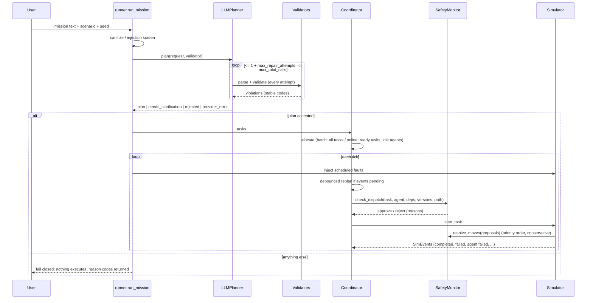

# Architecture

## Components and ownership

| Component | Module | Owns / does | Must not |
|---|---|---|---|
| Mission hygiene | `planner/mission_text.py` | strip control chars, length cap, injection screen | be the only defence |
| Planner interface | `planner/interface.py`, `llm_planner.py` | provider-independent `plan(request, validator)`; bounded retries/repairs | edit an invalid plan, execute anything |
| Providers | `planner/providers.py` | `MockProvider`, `FaultInjectingProvider`, `AnthropicProvider` | be referenced by core code |
| Schema validator | `validation/schema_validator.py` | JSON → typed `TaskSpec`, stable codes, strict (no extras, no coercion) | repair |
| Semantic validator | `validation/semantic_validator.py` | allowlists, DAG, depth/limits, report ordering, capability/reachability, mission coverage | repair |
| Cost service | `allocation/cost_model.py`, `environment.py` | A* distances, cost c_ij, hard feasibility | treat infeasibility as a cost |
| Allocators | `allocation/*.py` | task→agent assignment, infeasibility reasons | assign incapable agents |
| Coordinator | `coordinator.py`, `task_state.py` | authoritative task state/FSM, queues, dispatch, retries, replanning | mark success without simulator evidence |
| SafetyMonitor | `validation/safety_monitor.py` | allowlist, dispatch gate, central move resolution | delegate to the LLM |
| Simulator | `simulator.py`, `executor.py` | true positions/battery/outcomes, collision audit | accept unapproved actions |
| Logger / metrics | `logging_utils.py`, `metrics.py` | JSONL trace; metrics computed **only** from it | change state |

State ownership: the coordinator owns task state and assignments; the simulator owns physical truth; the LLM output is read once as data.

## Mission control flow

## Task state machine

`PENDING → ASSIGNED → READY → EXECUTING → SUCCEEDED` (terminal, immutable). `EXECUTING → FAILED | BLOCKED`; `FAILED/BLOCKED → PENDING` only through the replanner (which applies the retry policy and feasibility); `ASSIGNED/READY → PENDING` on release; `PENDING → BLOCKED` when no feasible agent exists. All 49 state pairs are tested.

## Simulation model (discrete)

4-connected grid, 1 cell/tick, tick = 5 s. Energy: 0.5/cell + per-task energy; battery never negative; below-reserve → `LOW_BATTERY`, agent `UNAVAILABLE`. A move is accepted only if the destination is passable, **unoccupied at the start of the tick**, not reserved by a higher-priority move, and not part of an opposite-direction edge swap. Blocked agents hold, re-route around static occupants, ask idle blockers to *yield* (yield moves outrank task moves), *retreat* when an idle blocker is boxed in, and resolve head-on meetings by one agent stepping aside; after `max_hold_ticks` a `DEADLOCK` event releases the task for replanning. An independent audit after every tick records any same-cell/edge-swap occurrence (never uses the monitor).

## Replanning

Triggers: `AGENT_FAILED`, `LOW_BATTERY`, `CELL_BLOCKED`, `TASK_ADDED`, `TASK_FAILED`, `ROUTE_UNREACHABLE`, `DEADLOCK`, `ALLOCATION_INVALID`. On a trigger: dispatch freezes; events are debounced (`min_replan_interval_ticks`); plan version increments; unstarted work is released; failed tasks are retried per policy (`safe_to_retry`; `verify_before_retry` checks the result registry; `no_automatic_retry` after side effects stays failed; attempts capped); blocked tasks are re-evaluated; the allocator re-runs on unfinished work only. **Completed work is never touched.** The LLM is not called again on events (re-decomposition only if the mission itself changes — not implemented as an automatic path). If nothing is feasible the mission ends `INCOMPLETE` with per-task reasons.
