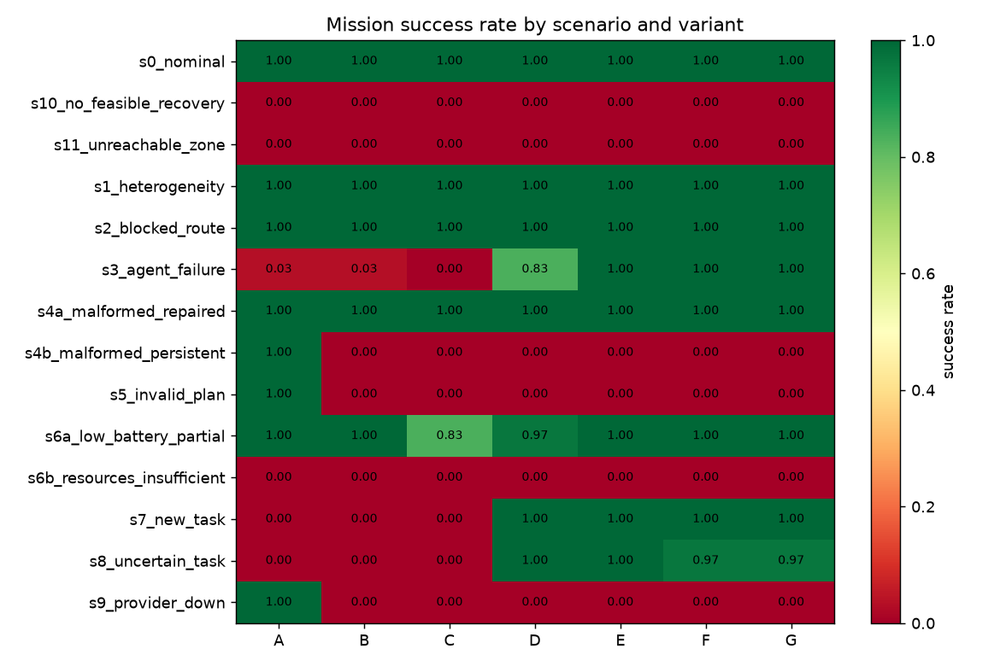
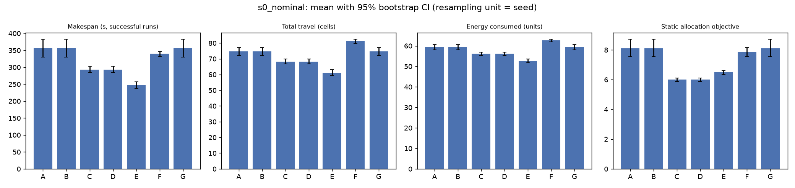
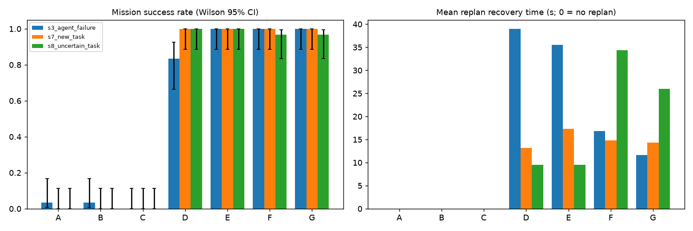
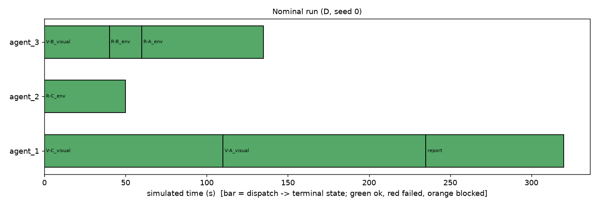
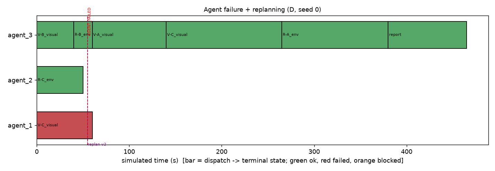
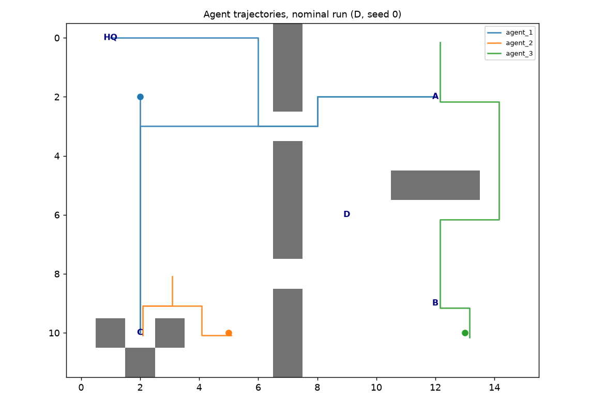
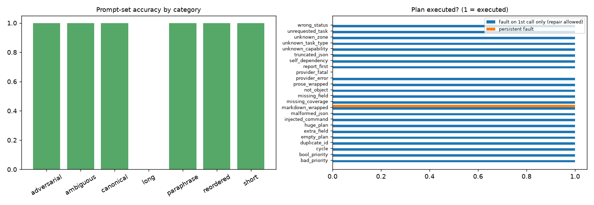

# Experiment report (auto-generated from saved results)

Generated 2026-10-18 by `autocollab report` from `results/runs.csv`. Every number below is computed from that file (which is computed from per-run event logs); nothing is typed by hand.

## 1. Provenance

- Runs: **2940** = 14 scenarios x 7 variants x 30 seeds (seeds 0..29). Wall time 80.4 s.
- Planner source: **mock (offline, deterministic keyword planner) - no real LLM involved**. These results say nothing about the quality of a real LLM; see section 6 for the planner harness.
- Settings digest: `4c5c4f6813c4`; allocation weights: {'distance': 1.0, 'time': 1.0, 'energy': 0.5, 'priority': 1.0, 'load': 0.5, 'makespan': 1.0}.
- Randomness (seeded, label-keyed so paired variants see identical draws): agent start jitter, battery jitter, task-duration jitter, failure-time windows.

## 2. Variants and scenarios

| variant | planner | allocator | replanning |
|---|---|---|---|
| A_manual_greedy | manual | greedy | off |
| B_mock_greedy | mock | greedy | off |
| C_mock_milp | mock | milp | off |
| D_mock_milp_replan | mock | milp | on |
| E_mock_nearest_replan | mock | nearest | on |
| F_mock_hungarian_replan | mock | hungarian | on |
| G_mock_greedy_replan | mock | greedy | on |

| scenario | description |
|---|---|
| s0_nominal | Reference scenario: 3 heterogeneous agents, 7 tasks with dependencies, no faults. |
| s10_no_feasible_recovery | Only agent_1 can report; it fails early. The report task has no feasible agent: must be reported, not hidden. (Modelling assumption: the failed agent is cleared from the grid and does not block its cell.) |
| s11_unreachable_zone | The only entrance (9,2) of zone C's alcove is blocked at tick 2: C becomes unreachable after validation. |
| s1_heterogeneity | Scarce capability: only agent_3 can take environmental readings; agent_2 can only navigate/report. |
| s2_blocked_route | Door (3,7) between the chambers is blocked at tick 3; the other door remains, so routes must be recomputed. |
| s3_agent_failure | agent_1 fails at a seeded tick in [8,16]; recovery is feasible via agent_3. (Modelling assumption: the failed agent is cleared from the grid and does not block its cell.) |
| s4a_malformed_repaired | First LLM response is malformed JSON; one bounded repair attempt succeeds. |
| s4b_malformed_persistent | Every LLM response is malformed: fail closed after one repair attempt, nothing executes. |
| s5_invalid_plan | The planner persistently proposes a cyclic dependency graph: rejected before allocation. |
| s6a_low_battery_partial | agent_1 starts with too little battery for any task; allocator must route work to agent_3 within its battery budget. |
| s6b_resources_insufficient | Every agent is below the battery needed for any task: no feasible allocation; mission must NOT claim success. |
| s7_new_task | A high-priority inspection of zone D is added at tick 10 while the mission runs. |
| s8_uncertain_task | agent_2 fails halfway through an environmental reading (non-idempotent: verify_before_retry). (Modelling assumption: the failed agent is cleared from the grid and does not block its cell.) |
| s9_provider_down | The LLM provider is persistently unavailable: bounded retries, then fail closed. |

## 3. Mission success rate (successes/runs, Wilson 95% CI)

| scenario | A | B | C | D | E | F | G |
|---|---|---|---|---|---|---|---|
| s0_nominal | 30/30 [0.89, 1.00] | 30/30 [0.89, 1.00] | 30/30 [0.89, 1.00] | 30/30 [0.89, 1.00] | 30/30 [0.89, 1.00] | 30/30 [0.89, 1.00] | 30/30 [0.89, 1.00] |
| s10_no_feasible_recovery | 0/30 [0.00, 0.11] | 0/30 [0.00, 0.11] | 0/30 [0.00, 0.11] | 0/30 [0.00, 0.11] | 0/30 [0.00, 0.11] | 0/30 [0.00, 0.11] | 0/30 [0.00, 0.11] |
| s11_unreachable_zone | 0/30 [0.00, 0.11] | 0/30 [0.00, 0.11] | 0/30 [0.00, 0.11] | 0/30 [0.00, 0.11] | 0/30 [0.00, 0.11] | 0/30 [0.00, 0.11] | 0/30 [0.00, 0.11] |
| s1_heterogeneity | 30/30 [0.89, 1.00] | 30/30 [0.89, 1.00] | 30/30 [0.89, 1.00] | 30/30 [0.89, 1.00] | 30/30 [0.89, 1.00] | 30/30 [0.89, 1.00] | 30/30 [0.89, 1.00] |
| s2_blocked_route | 30/30 [0.89, 1.00] | 30/30 [0.89, 1.00] | 30/30 [0.89, 1.00] | 30/30 [0.89, 1.00] | 30/30 [0.89, 1.00] | 30/30 [0.89, 1.00] | 30/30 [0.89, 1.00] |
| s3_agent_failure | 1/30 [0.01, 0.17] | 1/30 [0.01, 0.17] | 0/30 [0.00, 0.11] | 25/30 [0.66, 0.93] | 30/30 [0.89, 1.00] | 30/30 [0.89, 1.00] | 30/30 [0.89, 1.00] |
| s4a_malformed_repaired | 30/30 [0.89, 1.00] | 30/30 [0.89, 1.00] | 30/30 [0.89, 1.00] | 30/30 [0.89, 1.00] | 30/30 [0.89, 1.00] | 30/30 [0.89, 1.00] | 30/30 [0.89, 1.00] |
| s4b_malformed_persistent | 30/30 [0.89, 1.00] | 0/30 [0.00, 0.11] | 0/30 [0.00, 0.11] | 0/30 [0.00, 0.11] | 0/30 [0.00, 0.11] | 0/30 [0.00, 0.11] | 0/30 [0.00, 0.11] |
| s5_invalid_plan | 30/30 [0.89, 1.00] | 0/30 [0.00, 0.11] | 0/30 [0.00, 0.11] | 0/30 [0.00, 0.11] | 0/30 [0.00, 0.11] | 0/30 [0.00, 0.11] | 0/30 [0.00, 0.11] |
| s6a_low_battery_partial | 30/30 [0.89, 1.00] | 30/30 [0.89, 1.00] | 25/30 [0.66, 0.93] | 29/30 [0.83, 0.99] | 30/30 [0.89, 1.00] | 30/30 [0.89, 1.00] | 30/30 [0.89, 1.00] |
| s6b_resources_insufficient | 0/30 [0.00, 0.11] | 0/30 [0.00, 0.11] | 0/30 [0.00, 0.11] | 0/30 [0.00, 0.11] | 0/30 [0.00, 0.11] | 0/30 [0.00, 0.11] | 0/30 [0.00, 0.11] |
| s7_new_task | 0/30 [0.00, 0.11] | 0/30 [0.00, 0.11] | 0/30 [0.00, 0.11] | 30/30 [0.89, 1.00] | 30/30 [0.89, 1.00] | 30/30 [0.89, 1.00] | 30/30 [0.89, 1.00] |
| s8_uncertain_task | 0/30 [0.00, 0.11] | 0/30 [0.00, 0.11] | 0/30 [0.00, 0.11] | 30/30 [0.89, 1.00] | 30/30 [0.89, 1.00] | 29/30 [0.83, 0.99] | 29/30 [0.83, 0.99] |
| s9_provider_down | 30/30 [0.89, 1.00] | 0/30 [0.00, 0.11] | 0/30 [0.00, 0.11] | 0/30 [0.00, 0.11] | 0/30 [0.00, 0.11] | 0/30 [0.00, 0.11] | 0/30 [0.00, 0.11] |



## 4. Nominal operation (s0_nominal): allocation comparison

Mean [95% bootstrap CI over seeds]. Makespan and objective use successful runs only. `allocation_objective` is the common static c_ij sum of the executing agent assignments from the initial snapshot (identical formula for all allocators).

| variant | makespan (s) | travel (cells) | energy | alloc. objective |
|---|---|---|---|---|
| A_manual_greedy | 357.3 [329.7, 382.5] (n=30) | 74.8 [72.0, 77.2] (n=30) | 59.4 [58.0, 60.6] (n=30) | 8.11 [7.55, 8.71] (n=30) |
| B_mock_greedy | 357.3 [329.7, 382.5] (n=30) | 74.8 [72.0, 77.2] (n=30) | 59.4 [58.0, 60.6] (n=30) | 8.11 [7.55, 8.71] (n=30) |
| C_mock_milp | 293.3 [283.5, 303.0] (n=30) | 68.3 [66.7, 69.8] (n=30) | 56.1 [55.3, 56.9] (n=30) | 6.01 [5.89, 6.12] (n=30) |
| D_mock_milp_replan | 293.3 [283.5, 303.0] (n=30) | 68.3 [66.7, 69.8] (n=30) | 56.1 [55.3, 56.9] (n=30) | 6.01 [5.89, 6.12] (n=30) |
| E_mock_nearest_replan | 247.5 [238.2, 256.8] (n=30) | 61.2 [59.4, 63.1] (n=30) | 52.6 [51.7, 53.5] (n=30) | 6.49 [6.35, 6.63] (n=30) |
| F_mock_hungarian_replan | 340.2 [331.3, 347.2] (n=30) | 81.2 [79.8, 82.4] (n=30) | 62.6 [61.9, 63.2] (n=30) | 7.84 [7.57, 8.17] (n=30) |
| G_mock_greedy_replan | 357.3 [329.7, 382.5] (n=30) | 74.8 [72.0, 77.2] (n=30) | 59.4 [58.0, 60.6] (n=30) | 8.11 [7.55, 8.71] (n=30) |



Paired within-seed differences (y - x), s0_nominal:

| x -> y | metric | n pairs | mean diff | 95% CI |
|---|---|---|---|---|
| B -> C | makespan_s | 30 | -64.00 | [-95.83, -30.33] |
| B -> C | travel_cells | 30 | -6.50 | [-9.33, -3.57] |
| B -> C | energy_total | 30 | -3.25 | [-4.67, -1.78] |
| B -> C | allocation_objective | 30 | -2.11 | [-2.71, -1.55] |
| C -> D | makespan_s | 30 | 0.00 | [0.00, 0.00] |
| C -> D | travel_cells | 30 | 0.00 | [0.00, 0.00] |
| C -> D | energy_total | 30 | 0.00 | [0.00, 0.00] |
| C -> D | allocation_objective | 30 | 0.00 | [0.00, 0.00] |
| G -> D | makespan_s | 30 | -64.00 | [-95.83, -30.33] |
| G -> D | travel_cells | 30 | -6.50 | [-9.33, -3.57] |
| G -> D | energy_total | 30 | -3.25 | [-4.67, -1.78] |
| G -> D | allocation_objective | 30 | -2.11 | [-2.71, -1.55] |
| E -> D | makespan_s | 30 | 45.83 | [35.16, 56.17] |
| E -> D | travel_cells | 30 | 7.10 | [4.63, 9.50] |
| E -> D | energy_total | 30 | 3.55 | [2.32, 4.75] |
| E -> D | allocation_objective | 30 | -0.48 | [-0.61, -0.36] |
| F -> D | makespan_s | 30 | -46.83 | [-59.34, -33.00] |
| F -> D | travel_cells | 30 | -12.90 | [-14.97, -10.90] |
| F -> D | energy_total | 30 | -6.45 | [-7.48, -5.45] |
| F -> D | allocation_objective | 30 | -1.84 | [-2.12, -1.58] |
| A -> B | makespan_s | 30 | 0.00 | [0.00, 0.00] |
| A -> B | travel_cells | 30 | 0.00 | [0.00, 0.00] |
| A -> B | energy_total | 30 | 0.00 | [0.00, 0.00] |
| A -> B | allocation_objective | 30 | 0.00 | [0.00, 0.00] |

## 5. Faults, replanning and fail-closed behaviour

| scenario | variant | success | tasks done (mean completion rate) | recovery ticks (mean) | replans | invalid-plan rejections | collisions |
|---|---|---|---|---|---|---|---|
| s10_no_feasible_recovery | C | 0/30 | 0.66 | n/a | 0.00 | 0.00 | 0.00 |
| s10_no_feasible_recovery | D | 0/30 | 0.86 | 2.33 | 1.00 | 0.00 | 0.00 |
| s10_no_feasible_recovery | B | 0/30 | 0.71 | n/a | 0.00 | 0.00 | 0.00 |
| s10_no_feasible_recovery | E | 0/30 | 0.86 | 2.30 | 1.00 | 0.00 | 0.00 |
| s11_unreachable_zone | C | 0/30 | 0.60 | n/a | 0.00 | 0.00 | 0.00 |
| s11_unreachable_zone | D | 0/30 | 0.60 | 2.23 | 2.00 | 0.00 | 0.00 |
| s11_unreachable_zone | B | 0/30 | 0.57 | n/a | 0.00 | 0.00 | 0.00 |
| s11_unreachable_zone | E | 0/30 | 0.60 | 2.00 | 2.00 | 0.00 | 0.00 |
| s3_agent_failure | C | 0/30 | 0.66 | n/a | 0.00 | 0.00 | 0.00 |
| s3_agent_failure | D | 25/30 | 0.98 | 7.80 | 1.17 | 0.00 | 0.00 |
| s3_agent_failure | B | 1/30 | 0.76 | n/a | 0.00 | 0.00 | 0.00 |
| s3_agent_failure | E | 30/30 | 1.00 | 7.10 | 1.00 | 0.00 | 0.00 |
| s4a_malformed_repaired | C | 30/30 | 1.00 | n/a | 0.00 | 1.00 | 0.00 |
| s4a_malformed_repaired | D | 30/30 | 1.00 | n/a | 0.00 | 1.00 | 0.00 |
| s4a_malformed_repaired | B | 30/30 | 1.00 | n/a | 0.00 | 1.00 | 0.00 |
| s4a_malformed_repaired | E | 30/30 | 1.00 | n/a | 0.00 | 1.00 | 0.00 |
| s4b_malformed_persistent | C | 0/30 | 0.00 | n/a | 0.00 | 2.00 | 0.00 |
| s4b_malformed_persistent | D | 0/30 | 0.00 | n/a | 0.00 | 2.00 | 0.00 |
| s4b_malformed_persistent | B | 0/30 | 0.00 | n/a | 0.00 | 2.00 | 0.00 |
| s4b_malformed_persistent | E | 0/30 | 0.00 | n/a | 0.00 | 2.00 | 0.00 |
| s5_invalid_plan | C | 0/30 | 0.00 | n/a | 0.00 | 2.00 | 0.00 |
| s5_invalid_plan | D | 0/30 | 0.00 | n/a | 0.00 | 2.00 | 0.00 |
| s5_invalid_plan | B | 0/30 | 0.00 | n/a | 0.00 | 2.00 | 0.00 |
| s5_invalid_plan | E | 0/30 | 0.00 | n/a | 0.00 | 2.00 | 0.00 |
| s6a_low_battery_partial | C | 25/30 | 0.96 | n/a | 0.00 | 0.00 | 0.00 |
| s6a_low_battery_partial | D | 29/30 | 1.00 | 1.00 | 0.17 | 0.00 | 0.00 |
| s6a_low_battery_partial | B | 30/30 | 1.00 | n/a | 0.00 | 0.00 | 0.00 |
| s6a_low_battery_partial | E | 30/30 | 1.00 | n/a | 0.00 | 0.00 | 0.00 |
| s6b_resources_insufficient | C | 0/30 | 0.00 | n/a | 0.00 | 0.00 | 0.00 |
| s6b_resources_insufficient | D | 0/30 | 0.00 | n/a | 0.00 | 0.00 | 0.00 |
| s6b_resources_insufficient | B | 0/30 | 0.00 | n/a | 0.00 | 0.00 | 0.00 |
| s6b_resources_insufficient | E | 0/30 | 0.00 | n/a | 0.00 | 0.00 | 0.00 |
| s7_new_task | C | 0/30 | 0.88 | n/a | 0.00 | 0.00 | 0.00 |
| s7_new_task | D | 30/30 | 1.00 | 2.63 | 1.00 | 0.00 | 0.00 |
| s7_new_task | B | 0/30 | 0.88 | n/a | 0.00 | 0.00 | 0.00 |
| s7_new_task | E | 30/30 | 1.00 | 3.47 | 1.00 | 0.00 | 0.00 |
| s8_uncertain_task | C | 0/30 | 0.63 | n/a | 0.00 | 0.00 | 0.00 |
| s8_uncertain_task | D | 30/30 | 1.00 | 1.90 | 1.00 | 0.00 | 0.00 |
| s8_uncertain_task | B | 0/30 | 0.68 | n/a | 0.00 | 0.00 | 0.00 |
| s8_uncertain_task | E | 30/30 | 1.00 | 1.90 | 1.00 | 0.00 | 0.00 |
| s9_provider_down | C | 0/30 | 0.00 | n/a | 0.00 | 0.00 | 0.00 |
| s9_provider_down | D | 0/30 | 0.00 | n/a | 0.00 | 0.00 | 0.00 |
| s9_provider_down | B | 0/30 | 0.00 | n/a | 0.00 | 0.00 | 0.00 |
| s9_provider_down | E | 0/30 | 0.00 | n/a | 0.00 | 0.00 | 0.00 |









**Safety audit (simulated):** 0 collisions (same-cell or edge-swap) observed by the independent per-tick audit across 2940 runs; the SafetyMonitor rejected/held 9033 proposed moves. This is evidence for the tested scenarios in a discrete simulator only, not a safety guarantee.

## 6. Planner evaluation (separate from the simulation runs)

- Provider: **mock** / model `rule-based-v1`. mock provider = keyword parser; scores measure the harness, not LLM quality.
- Labelled prompt set: 14 prompts, overall accuracy 0.93; plan-validity rate on prompts that should yield a plan 0.88 (Wilson 95% CI [0.53, 0.98], n=8).
- Per-prompt outcomes: `planner_eval/prompts.csv`; corruption matrix: `planner_eval/fault_modes.csv`.
- Fault-mode matrix: plans executed under a *persistent* corruption (excluding the benign markdown-fence case): **0**.



## 7. Limitations of this report

- Planner = deterministic keyword mock; identical task graphs for A and B are expected, so A-vs-B differences reflect only the planner path, not LLM variability.
- Static MILP assignment ignores sequence-dependent travel; greedy is route-aware, so MILP is not guaranteed to beat greedy on distance/makespan.
- Discrete grid, 4-connected unit-cost moves; safety results do not transfer to physical robots.
- Failure scenarios s3/s8/s10 assume the failed agent is cleared from the grid (configurable).
- Confidence intervals treat seeds as independent draws; the 30-seed design gives limited power for small effects.

## 8. Reproduce

```bash
autocollab experiments --seeds 30 --jobs 4 --out results
autocollab planner-eval --provider mock --out results/planner_eval
autocollab plots --results results
autocollab report --results results
```
